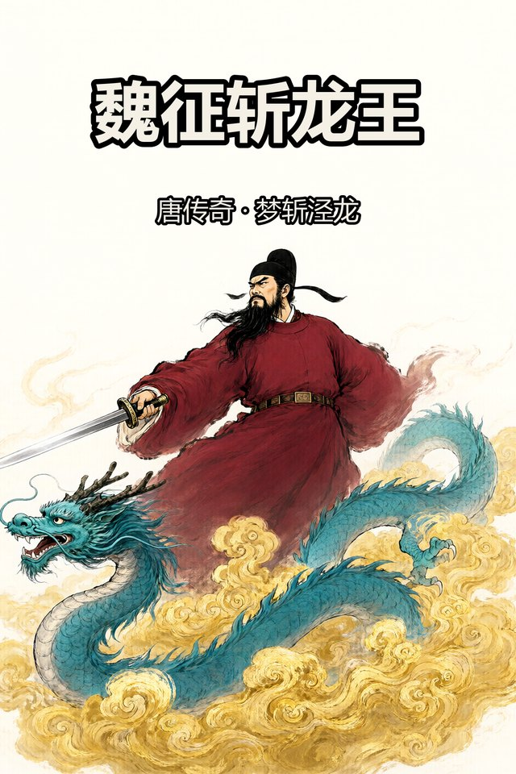
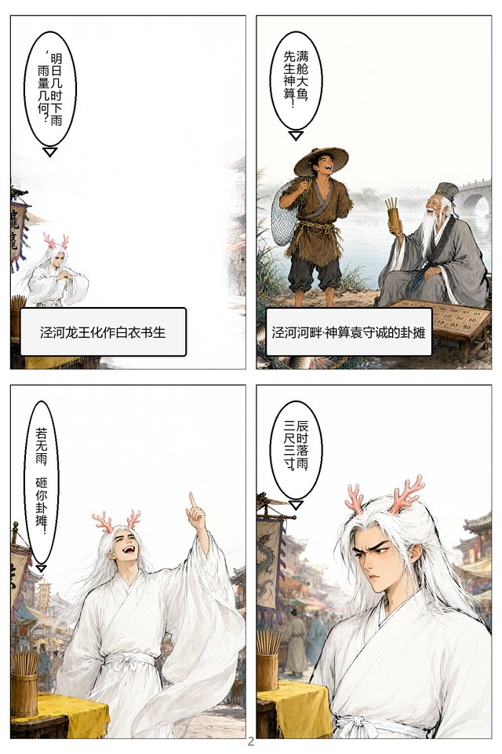
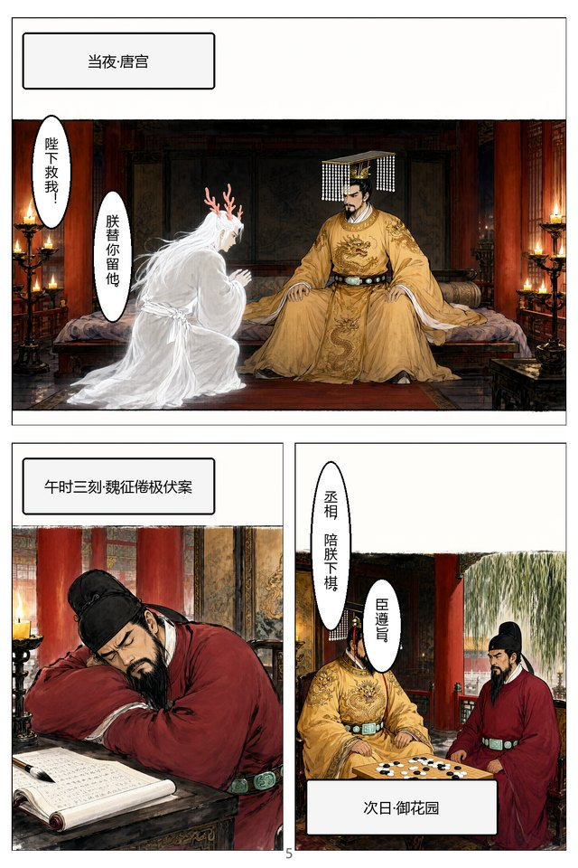
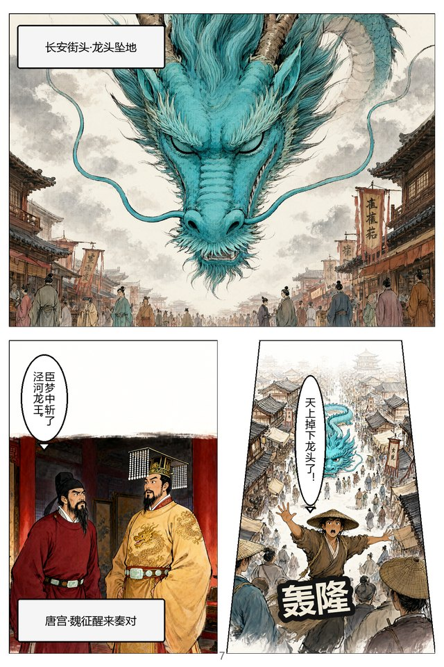
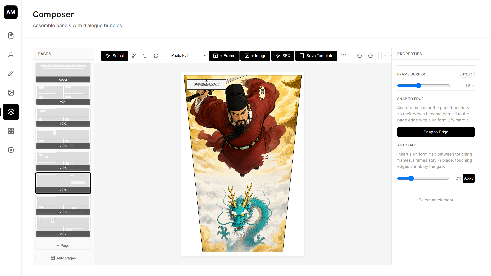
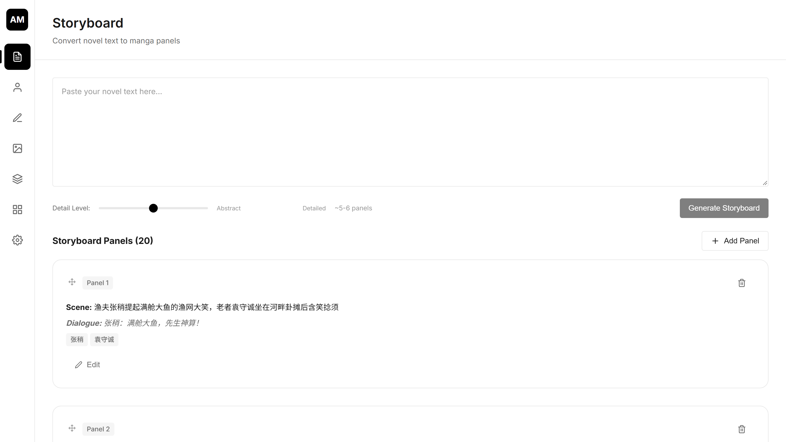
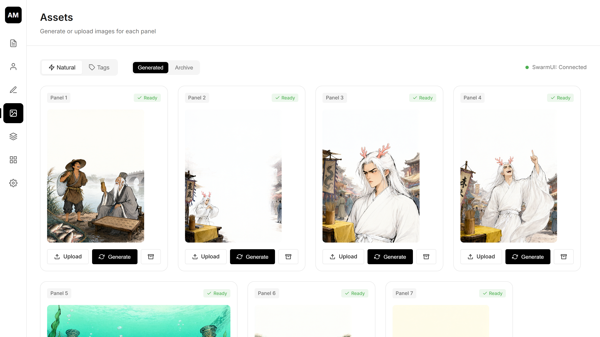
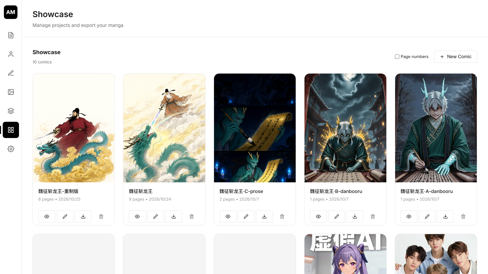
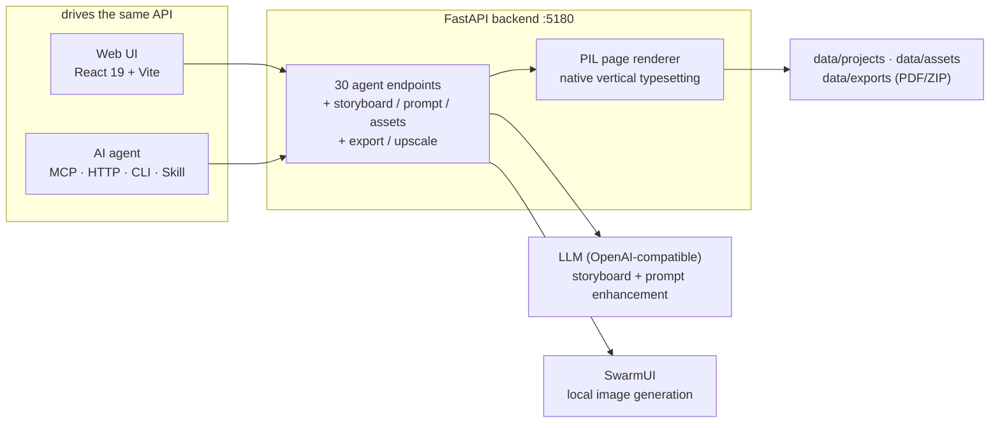

<div align="center">


# TT_AutoManga

**From one idea to a finished comic — automatically.**

A story goes in; storyboarded, AI-illustrated, lettered and exported manga
pages come out. Drive it from the web UI or hand the whole pipeline to an AI
agent — same data, same API.

**[English](README.md) · [简体中文](README.zh-CN.md)**

</div>

---

## 🎬 Demo

<!-- Swap the source below for a GitHub user-attachment URL or YouTube embed
     whenever a hosted version exists — everything else stays the same. -->

<p align="center">
  <a href="docs/assets/demo.mp4"></a>
</p>
<p align="center">
  <a href="docs/assets/demo.mp4"><strong>▶ Watch the showcase (78s)</strong></a>
  — one idea, twenty panels, eight finished pages, zero manual drawing.
  Built with the app itself and rendered as code (<code>docs/video/</code>).
</p>

## What it does

```
idea ──► storyboard ──► image generation ──► page assembly ──► lettering ──► PDF / ZIP
         20 panels       SwarmUI, any model    27 templates       vertical text   page numbers
         with shots      seeds & variants      dynamic frames     SFX & captions  up to 4800×7200
```

The pipeline is **agent-first**: every step above is exposed as a typed tool
(28 MCP tools, 30 REST endpoints, a CLI and an agent skill), so an LLM agent
can take *"make me a comic about X"* and run the whole thing — while a human
can open the same project in the UI and polish anything by hand. Both read
and write the same project JSON.

<details>
<summary><strong>The real production run behind the demo</strong> (click to expand)</summary>

The demo comic 《魏征斩龙王》 (Wei Zheng Slays the Dragon King, a classic
Tang-dynasty tale) was produced end-to-end by an AI agent driving this
pipeline: one Chinese prose prompt per panel, `qwen-image` for artwork,
rigid per-character prompt blocks for consistency, automatic dialogue
bubbles with speaker detection, native vertical lettering, and a trapezoid
frame where the art's own perspective calls for it.

| | |
|---|---|
|  |  |
|  |  |

</details>

## ✨ Tour

<p align="center">
  <br>
  <em>Visual composer — pages, frames, bubbles, SFX; the properties panel
  offers snap-to-edge and auto-gap so frame dividers stay parallel</em>
</p>

<p align="center">
  <br>
  <em>Storyboard — one editable card per panel: scene, characters, shot,
  dialogue (speaker-aware)</em>
</p>

<p align="center">
  <br>
  <em>Assets — generate / regenerate / upload per panel, with variants and
  transparent-background overlays</em>
</p>

<p align="center">
  <br>
  <em>Showcase — every comic with its cover; view, edit, export, delete</em>
</p>

## ✨ Features

**Storyboard & story**
- LLM storyboard generation from novel text (detail-level slider), or write panels by hand
- Per panel: scene, characters, dialogue (`"Name：line"` marks the speaker), shot type (wide / medium / close-up / ECU / splash), location
- Project style profile, character prompt blocks, location blocks and a story bible — injected into every generation for cross-chapter continuity

**Image generation**
- SwarmUI integration; any installed model — danbooru-tag (SDXL/Illustrious/NoobAI) or natural-language (qwen-image) families, with per-request model / LoRA / prompt-format overrides
- Batch jobs with per-item errors, variants 1-4 with apply-what-you-like, fixed seeds for reproducibility
- img2img chaining (`init_image` + creativity) and mask inpainting for consistency and spot repairs
- Transparent-background overlays with automatic fallback matting; every PNG embeds its full generation recipe
- Local Real-ESRGAN upscaling (ONNX) for print-grade key art

**Page assembly & lettering**
- 27 built-in templates (manga / grid / hero / photo / webtoon long-strip / dynamic), custom row layouts, user-saved templates
- Automatic dialogue bubbles: speaker detection, opposite tails for two-speaker panels, slim balloons on close-ups
- Native CJK vertical typesetting: tight balanced columns (**≥5 glyphs per column, enforced**), vertical punctuation forms (︐ ︕ ︒ …)
- Style budget enforced by the pipeline: plain speech balloons by default; shout / whisper / narration as deliberate accents
- SFX text with stroke outline (era-appropriate presets), narration caption boxes, trapezoid frames that fill with art when the composition has real perspective
- Drag-a-line frame splitting in the composer, snap-to-edge / auto-gap, undo/redo

**Export & quality**
- PDF + ZIP in one call, page numbers (cover exempt), render scale up to 8× (4800×7200)
- Mandatory visual QC loop: any page renders to PNG at any scale for an agent (or you) to inspect
- 129 backend tests; path-traversal / id-injection / key-masking security hardening audited in a dedicated pass

## 🏗 Architecture



## 🚀 Quick Start

**Prerequisites**

- **Python 3.10+** — use a virtual environment (`python -m venv .venv`)
- **Node.js 20+** and npm
- *(Optional)* [SwarmUI](https://github.com/mcmonkeyprojects/SwarmUI) on `127.0.0.1:7801` for image generation
- *(Optional)* An OpenAI-compatible LLM endpoint (Ollama, vLLM, OpenAI, …)

```bash
# 1. backend dependencies
pip install -r backend/requirements.txt

# 2. frontend dependencies
cd frontend && npm install && cd ..

# 3. build the frontend (or `npm --prefix frontend run dev` for HMR)
npm --prefix frontend run build

# 4. start the server (serves the UI at http://localhost:5180)
python -m backend.main 5180
```

On Windows, `run.bat` does all of the above.

## 🤖 Agent access (MCP / Skill / CLI)

The pipeline is built to be **taken over by an AI agent** — any harness, any
model, no vendor lock-in:

- **MCP server** — `python -m backend.mcp_server` (stdio; deps in
  `backend/requirements-mcp.txt`). 28 typed tools covering the full workflow;
  `render_page_preview` returns image content so multimodal agents can *see*
  and QC their own pages. Register with any MCP client:

  ```json
  {
    "mcpServers": {
      "automanga": {
        "command": "python",
        "args": ["-m", "backend.mcp_server"],
        "cwd": "D:/path/to/TT_AutoManga",
        "env": {
          "AUTOMANGA_URL": "http://127.0.0.1:5180",
          "PYTHONPATH": "D:/path/to/TT_AutoManga"
        }
      }
    }
  }
  ```

- **Agent Skill** — `skills/manga-maker/SKILL.md` follows the open
  [agentskills.io](https://agentskills.io) format: drop it into your agent's
  skills directory and it learns the full production craft — reader test,
  storyboard grammar, the character-consistency protocol, lettering
  discipline and the 7-point visual QC checklist. Content-neutral: the
  pipeline applies no filtering; content decisions stay with you and the
  model you drive it with.
- **HTTP / CLI** — `AGENTS.md` is the operator manual (golden path, schema,
  limits); `GET /openapi.json` is the machine schema; or use
  `python -m backend.agent_cli --help`.

## ⚙️ Configuration

Settings live in `data/settings.json` (gitignored, created on first change):

- **API Endpoint / Key / Model** — any chat-completions-compatible LLM (point at `http://127.0.0.1:11434/v1` for Ollama)
- **SwarmUI** — address plus presets combining model, LoRAs, steps, CFG, sampler and a global prompt suffix

## 🎞 The demo film is code

`docs/video/` contains the showcase film's source: an `index.html` whose
`window.render(t)` draws frame *t* deterministically (paper, ink, Ken-Burns
over real pages and screenshots), and `build.mjs` which samples it with
headless Chrome and muxes with ffmpeg — no video-generation model involved.
Tweak a scene, re-run `node build.mjs`, get a new cut.

## 🛠 Tech Stack

| Layer | Tech |
|---|---|
| Frontend | React 19, TypeScript, Vite, Zustand, framer-motion, @dnd-kit |
| Backend | FastAPI, pydantic v2, httpx, openai |
| Renderer | Pillow (server-side page renderer with native vertical typesetting) |
| Export | ReportLab (PDF), Pillow / ZIP |
| Upscale | ONNX Runtime (Real-ESRGAN) |
| AI | Any OpenAI-compatible LLM + SwarmUI |

## 📁 Project Structure

```
backend/          FastAPI app (api/, storage/, render/)
  agent.py        30 agent endpoints — the whole pipeline over HTTP
  mcp_tools.py    28 MCP tools mirroring the API
  assembly.py     template filling + automatic dialogue bubbles
  render/         server-side page renderer + vertical typesetting
  inference.py    local Real-ESRGAN upscaling
frontend/         React UI (storyboard, prompt lab, composer, showcase)
skills/manga-maker/   agent skill (production SOP + craft playbook)
docs/video/       demo film source (render(t) + frame sampler)
AGENTS.md         operator manual for AI agents
```

## 🤝 Contributing

Issues and PRs welcome. Backend tests: `python -m pytest backend/tests/`
(129 green). Frontend typecheck: `npm --prefix frontend run build`.

## 📄 License

MIT — see [LICENSE](LICENSE).

## ⚠️ Note

TT_AutoManga executes your creative direction as given. Story themes,
maturity level and imagery style are decided by the operator and the models
they configure; the pipeline itself neither filters nor judges content.
