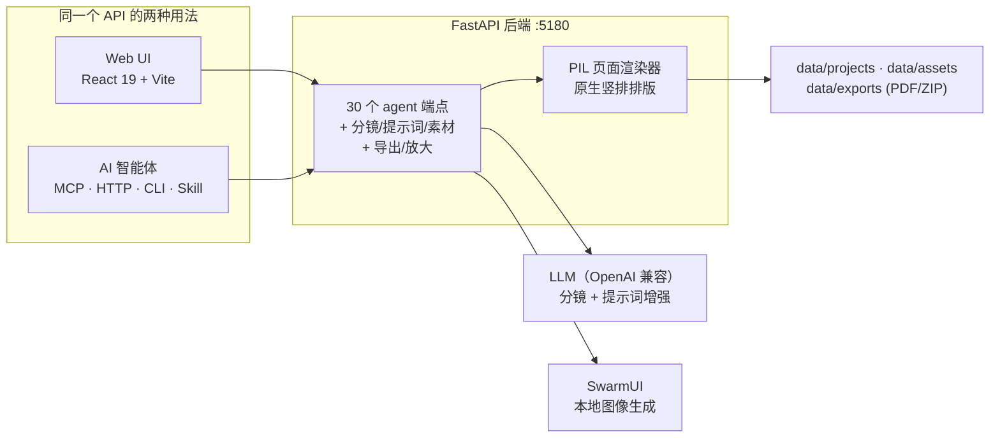

<div align="center">


# TT_AutoManga

**从一个想法，到一部漫画——全自动。**

故事进来，排好版、画好图、配好对白的漫画页出去。你可以用网页操作，
也可以把整条流水线交给 AI 智能体——同一份数据，同一套 API。

**[English](README.md) · [简体中文](README.zh-CN.md)**

</div>

---

## 🎬 演示

<p align="center">
  <a href="docs/assets/demo.mp4"></a>
</p>
<p align="center">
  <a href="docs/assets/demo.mp4"><strong>▶ 观看演示（78 秒）</strong></a>
  —— 一个想法，二十格分镜，八页成品，全程零手绘。
  演示片本身也由代码渲染（<code>docs/video/</code>）。
</p>

## 它做什么

```
想法 ──► 分镜 ──► 出图 ──► 排版 ──► 排字 ──► PDF / ZIP
        20 格      SwarmUI    27 模板    竖排紧排    自动页码
        带景别     任意模型   动态斜框   SFX/旁白    最高 4800×7200
```

管线是 **Agent 优先**的：上面每一步都是类型化工具（28 个 MCP 工具、
30 个 REST 端点、CLI、Agent Skill），LLM 智能体接到"给我画一部关于 X
的漫画"就能跑完全程；人也可以在 UI 里打开同一项目手工打磨。两边读写
同一份 project.json。

<details>
<summary><strong>演示漫画背后的真实生产</strong>（点击展开）</summary>

演示漫画《魏征斩龙王》由 AI 智能体驱动本管线端到端完成：每格一段中文
散文提示词、qwen-image 出图、刚性角色提示块保证一致性、自动对白气泡
（说话人识别）、原生竖排排字、以及画面透视需要的梯形分镜框。

| | |
|---|---|
|  |  |
|  |  |

</details>

## ✨ 功能

**分镜与故事**
- LLM 把小说文本拆成分镜（细粒度可调），或手写每格
- 每格：场景、角色、台词（"名字：台词"自动识别说话人）、景别（远/中/特/大特/全页）、场景地点
- 项目画风、角色提示块、场景库、故事圣经——注入每次生成，跨章节保持连贯

**图像生成**
- 对接 SwarmUI；支持 danbooru 标签系（SDXL/Illustrious/NoobAI）与自然语言系（qwen-image），按请求覆盖模型 / LoRA / 提示词格式
- 批量任务逐格报错；变体 1-4 挑选采用；固定种子可复现
- 图生图链（init_image + 创作度）与蒙版局部重绘
- 透明背景覆盖层（自动抠图兜底）；每张 PNG 内嵌完整生成配方
- 本地 Real-ESRGAN（ONNX）放大到印刷级

**排版与排字**
- 27 套内置模板（漫画/网格/主格/照片/条漫长图/动态），自定义行布局，可存用户模板
- 自动对白气泡：说话人识别、双人分向气泡尾、特写格窄气泡
- 原生中文竖排排版：紧排均衡分列（**每列 ≥5 字，管线强制**）、竖排标点（︐ ︕ ︒ …）
- 排字风格预算由管线强制：默认全部椭圆气泡；尖角/耳语/旁白是显式的重音
- SFX 描边字（时代合适的拟声词预设）、旁白框、画面有透视时铺满画面的梯形框
- 排字器"拖一条线"切分分镜框、贴边对齐/自动均匀间距、撤销重做

**导出与质量**
- 一次调用同时出 PDF + ZIP，自动页码（封面免页码），渲染倍率最高 8×（4800×7200）
- 强制视觉 QC 环节：任意页面任意倍率渲染成 PNG，交给智能体（或你）过目
- 129 个后端测试；路径穿越 / id 注入 / 密钥掩码等安全加固经过专项审计

## 🏗 架构



## 🚀 快速开始

- **Python 3.10+**（建议虚拟环境）、**Node.js 20+**
- （可选）[SwarmUI](https://github.com/mcmonkeyprojects/SwarmUI) 跑在 `127.0.0.1:7801`
- （可选）OpenAI 兼容 LLM 端点

```bash
pip install -r backend/requirements.txt
cd frontend && npm install && cd ..
npm --prefix frontend run build
python -m backend.main 5180     # UI 在 http://localhost:5180
```

Windows 直接运行 `run.bat`。

## 🤖 智能体接入（MCP / Skill / CLI）

- **MCP 服务**：`python -m backend.mcp_server`（stdio），28 个类型化工具，
  `render_page_preview` 直接返回图像内容，多模态智能体能"看见"并自查页面。
  注册示例（Claude Desktop / Codex / Cursor / ZCode 通用）：

  ```json
  {
    "mcpServers": {
      "automanga": {
        "command": "python",
        "args": ["-m", "backend.mcp_server"],
        "cwd": "D:/path/to/TT_AutoManga",
        "env": {
          "AUTOMANGA_URL": "http://127.0.0.1:5180",
          "PYTHONPATH": "D:/path/to/TT_AutoManga"
        }
      }
    }
  }
  ```

- **Agent Skill**：`skills/manga-maker/SKILL.md`（agentskills.io 格式），
  内含完整制作 SOP 与工艺手册；内容中立，管线不做过滤
- **HTTP / CLI**：`AGENTS.md` 是操作手册；`GET /openapi.json` 是机器 schema；
  或用 `python -m backend.agent_cli --help`

## 🎞 演示片是代码

`docs/video/` 是演示片的源码：`index.html` 的 `window.render(t)` 确定性地
画出第 t 帧（纸张、水墨、真实页面与截图的 Ken-Burns），`build.mjs` 用无头
Chrome 逐帧采样、ffmpeg 合成——没有使用任何视频生成模型。改一个分镜，
重跑 `node build.mjs`，就是新的一版。

## 🛠 技术栈

| 层 | 技术 |
|---|---|
| 前端 | React 19, TypeScript, Vite, Zustand, framer-motion, @dnd-kit |
| 后端 | FastAPI, pydantic v2, httpx, openai |
| 渲染 | Pillow（服务端页面渲染器，原生竖排排版） |
| 导出 | ReportLab (PDF), Pillow / ZIP |
| 放大 | ONNX Runtime (Real-ESRGAN) |
| AI | 任意 OpenAI 兼容 LLM + SwarmUI |

## 🤝 参与贡献

欢迎 Issue 与 PR。后端测试：`python -m pytest backend/tests/`（129 通过）。
提交前请勿提交 `data/` 下的任何内容——那是用户的私有数据。

## 📄 许可

MIT —— 见 [LICENSE](LICENSE)。

## ⚠️ 说明

TT_AutoManga 按你的创作指令执行。故事题材、尺度与画风由操作者及其配置的
模型决定；管线本身不做过滤，也不做内容评判。

---

<div align="center">

**[English](README.md) · [简体中文](README.zh-CN.md)**

Made with ❤️ by [TTDiang2](https://github.com/TTDiang2)

</div>
